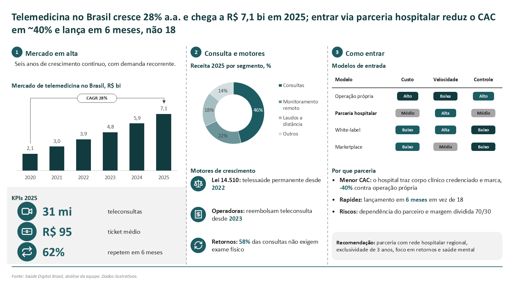
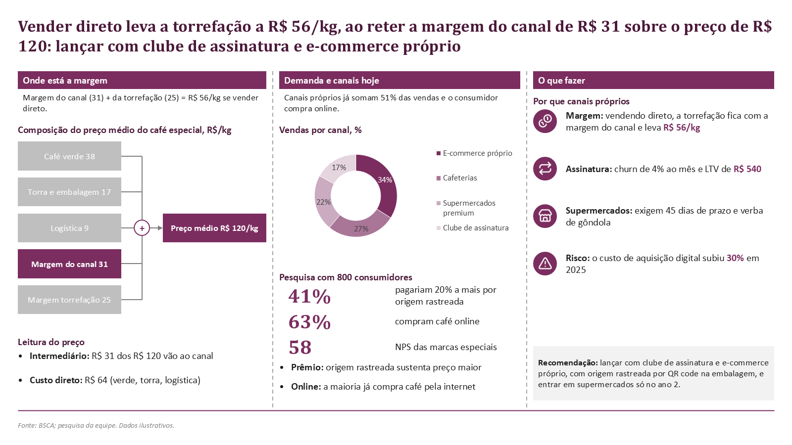
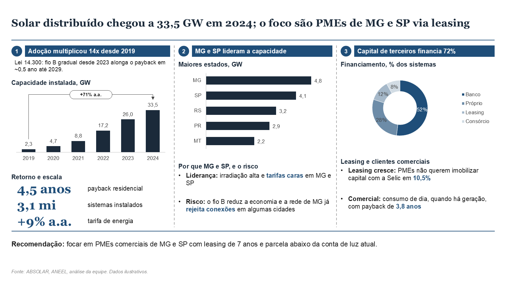
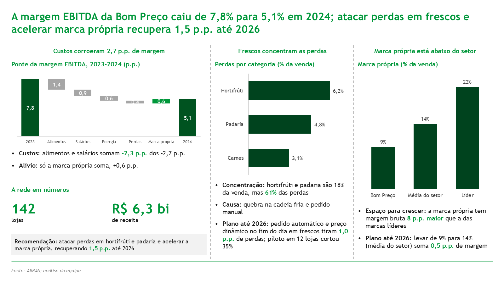
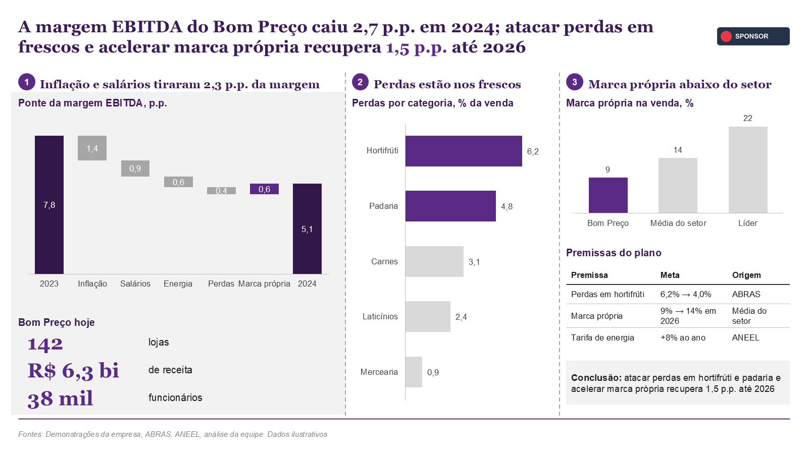

# Consulting slide skill for Claude

Turn your data, notes and research into **one finished, editable PowerPoint slide** in case-competition consulting style: action title, charts, tables, cost trees, KPIs, sources. You type a request to Claude, and Claude builds the slide for you.

- Native PowerPoint: real charts and text boxes you can edit, not images.
- Dense by default, organized into 2-3 marked sections. The layout follows your content: Claude doesn't paste the same template every time.
- Portuguese or English, with several styles (`bain_red`, `lek_green`, `orange_graphite`, `teal_modern`, `blue_slate`, `plum_classic`, `indigo_clean`, ...). You can also extract a style from any .pptx or .pdf.
- Runs on your own Claude subscription (Claude Code or Claude Desktop). No API key needed.

## Examples

The same tool in six styles. Every slide was made by the tool from a one-message request, is native PowerPoint and fully editable. All the data in these examples is illustrative.

| | |
|---|---|
|  |  |
| `orange_graphite`: EV charging CAPEX tree, cash flow with payback, sourced assumptions | `teal_modern`: telemedicine market, revenue mix, entry-model ratings and KPIs |
|  |  |
| `plum_classic`: specialty-coffee price tree, sales channels, consumer KPIs | `blue_slate`: distributed solar KPIs, growth, top states and financing mix |
|  |  |
| `lek_green`: margin bridge, losses by category, plan with sources | `indigo_clean`: sanitation investment gap, needs and contract models |

Want your own colours, fonts and logo? See [Use your own design](#use-your-own-design-colours-fonts-logo).

## What you need

- **Claude**: a Pro or Max plan with **Claude Code** (terminal or VS Code extension) or **Claude Desktop**.
- **Python 3.11 or newer**: [python.org/downloads](https://www.python.org/downloads/). On Windows, tick "Add python.exe to PATH" during install.
- **Microsoft PowerPoint, on Windows** (recommended): Claude uses it to render a picture of the slide and check it. Without it (on a Mac, for example) the .pptx is still built; Claude just can't see it before handing it over.
- **Git** (optional): to download and update the project. Without it, use *Code -> Download ZIP* on the GitHub page.

## Install (once)

1. Download the project:
   ```
   git clone https://github.com/gzimmerdev/consulting-slide-skill.git
   cd consulting-slide-skill
   ```
2. Install the Python packages:
   ```
   py -3 -m pip install -r requirements.txt
   ```
   On macOS or Linux, use `python3` wherever these instructions say `py -3`.
3. Check that it works. This builds an example slide into `out/test.pptx`:
   ```
   py -3 build.py examples/composite_coldchain.pt.json -o out/test.pptx
   ```

Then set up one of the two ways to use it below.

## Option A: Claude Code (recommended)

1. Open a terminal **in the project folder** and start Claude Code with `claude`, or open the folder in VS Code and open the Claude Code panel.
2. Type `/slide` followed by your request (example below). Claude:
   - reads your data;
   - picks a composition that fits it and says why;
   - builds the slide, renders it, checks it and fixes problems;
   - replies with the path of the `.pptx` (in `out/`).

The skill lives in `.claude/skills/slide/`, so Claude Code finds it automatically whenever it is started in this folder.

## Option B: Claude Desktop

1. Print your personal config block:
   ```
   py -3 tools/desktop_config.py
   ```
2. In Claude Desktop, go to **Settings -> Developer -> Edit Config**, paste the `"slidegen"` block inside `"mcpServers": { ... }` and save.
3. Optional: so that typing `/slide` works in Desktop, go to **Settings -> Capabilities -> Skills** and upload `desktop/slide.zip`.
4. **Quit Claude Desktop completely** (tray or menu-bar icon -> Quit) and open it again.
5. In a new chat, type `/slide` followed by your request. Without step 3, start with "Usando o slidegen, ..." / "Using slidegen, ..." instead: otherwise Desktop may use its own generic slides skill.

Slides are saved in `out/mcp/`. Ask Claude "abre no PowerPoint" / "open it in PowerPoint" to open one. More detail is in [docs/mcp.md](docs/mcp.md).

## How to ask for a slide

Give Claude **all the data in one message**: numbers, the breakdowns, the comparison, *why* the numbers are what they are, the risks, your recommendation and the source. Numbers alone give a sparse slide: Claude never invents the reasons, so the text on the slide comes from what you tell it. The more structure you give, the better the composition. Example:

```
/slide Gera um slide: a margem EBITDA da rede Bom Preço caiu de 7,8% em 2023 para 5,1% em 2024.
Ponte da margem (p.p.): 2023 7,8; inflação de alimentos -1,4; salários -0,9; energia -0,6; perdas -0,4;
marca própria +0,6; 2024 5,1. Perdas por categoria (% da venda): hortifrúti 6,2; padaria 4,8; carnes 3,1.
Hortifrúti e padaria são 18% da venda, mas 61% das perdas, por quebra na cadeia fria e pedido manual.
Marca própria: Bom Preço 9%, média do setor 14%, líder 22%; margem bruta 8 p.p. maior que a das marcas líderes.
Plano até 2026: pedido automático e preço dinâmico em frescos tiram 1,0 p.p. de perdas (piloto em 12 lojas
cortou 35%); levar a marca própria a 14% soma 0,5 p.p. KPIs: 142 lojas, R$ 6,3 bi de receita.
Recomendação: atacar perdas em hortifrúti e padaria e acelerar marca própria. Fonte: ABRAS, análise da equipe.
```

Tips:
- **Style:** say which one ("estilo lek_green"). For the list of styles, run `py -3 build.py --styles` or ask Claude.
- **Language:** write the request in English, or add "in English", to get an English slide.
- **Excel:** point Claude to a file and range ("data in dados.xlsx, sheet Mercado, A1:F6") instead of typing the numbers.
- **Sources:** Claude never invents a source. Without one, the slide says "Dados ilustrativos".
- **Approval:** when you like a slide, tell Claude it is approved. It saves the slide to `exemplars/` so later slides can learn from it.
- **Thin data:** if you give little data, Claude first tells you the slide may be less dense than usual, then shows what fits.

## Use your own design (colours, fonts, logo)

You can make the slides look like your own club's or team's slides. Below is the same margin slide in a custom purple style with Georgia titles and a logo in the top right:



- **Copy the design of slides you already made:** send Claude a .pptx or .pdf: "/slide copia o design de C:\...\nosso_deck.pptx e usa em todos os slides". Claude reads:
  - the colours (main and chart colours);
  - the fonts;
  - the title size;
  - the corner style;
  - your logo, if it repeats in a slide corner.

  Then it builds a sample slide, compares it with your deck and adjusts what differs.
- **Or just say it:** "nossa cor é #1F6FEB, títulos em Georgia, logo em C:\...\logo.png no canto superior direito". Screenshots of your slides work too: Claude reads the colours from them.
- **Make it the default:** say "usa esse estilo em todos os slides". From then on, every slide uses it without you asking.

Your styles and logos are saved in `my_styles/` on your own computer. They aren't uploaded to GitHub, and `git pull` doesn't touch them. You can also do it from the terminal:
```
py -3 tools/style_from_deck.py nosso_deck.pptx --save clube --default
py -3 tools/style_from_deck.py --set clube primary=#1F6FEB heading_font=Georgia --logo logo.png --logo-position top-right
py -3 tools/style_from_deck.py --list
```
If a font from your deck isn't installed on the computer, Claude warns you and offers a replacement. Everything you can change is listed in [docs/styles.md](docs/styles.md).

## Updating

```
git pull
py -3 -m pip install -r requirements.txt
```
With Claude Desktop, quit and reopen it after updating.

## Troubleshooting

| Problem | Fix |
|---|---|
| `py` is not recognized | Python is not on PATH. Reinstall Python with "Add to PATH" ticked, or use `python` / `python3`. |
| Desktop doesn't show the slidegen tools | Check the config with `py -3 tools/desktop_config.py`, then quit Desktop completely and reopen it. On Windows, `py -3 -I tools/check_desktop.py` checks the whole setup. |
| Desktop makes a generic, ugly slide | It used its own slides skill. Upload `desktop/slide.zip` (Option B, step 3), or start the message with "Usando o slidegen". |
| "preview failed" | Rendering needs Windows + PowerPoint. The .pptx is still in `out/`; open it yourself. |
| Fonts look different | The style's fonts aren't installed. Ask Claude for another font ("use Arial"). |

## What's inside

- `slidegen/`: the renderer: layouts, native charts, tables, cost trees, styles (`themes.json`).
- `build.py`: builds a slide from a JSON spec (`py -3 build.py spec.json -o out/x.pptx`).
- `tools/compose.py`: the recommender. It reads your content and proposes structurally different compositions.
- `mcp_server.py`: the tools Claude Desktop uses.
- `.claude/skills/slide/`: the Claude Code skill. `desktop/slide/` is the Claude Desktop version.
- `examples/`, `exemplars/`: example and approved slides that Claude checks its work against.
- `analysis/`, `brain/30-patterns/`: anonymized statistics from about 900 slides of 27 case-competition decks (layout habits, density), used as the "grammar" of the style. The source decks and anything identifying other teams are **not** included.
- `docs/`: spec reference (`archetypes.md`), styles (`styles.md`), design decisions (`rulings.md`), known gaps (`gaps.md`).

To change the code, read [AGENTS.md](AGENTS.md) first. Run the tests listed there before you commit.

## Contributing

Suggestions and improvements are welcome. Open an *issue* to report a problem or ask for a feature, or fork the repository and open a *pull request*. Changes reach the project only after the maintainer reviews and approves them. Please run the tests in [AGENTS.md](AGENTS.md) before opening a pull request.

## License and credits

[MIT](LICENSE): free to use, copy and modify, keeping the copyright notice.

Icons: [Lucide](https://lucide.dev) (ISC license, `assets/icons/lucide/`).
